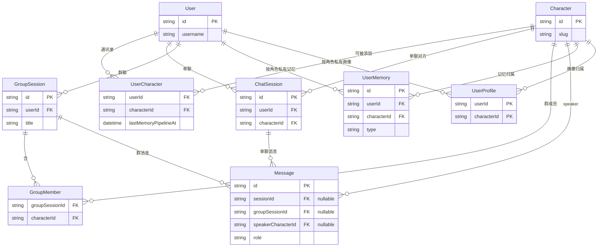

# 数据模型

权威结构见 [`prisma/schema.prisma`](../prisma/schema.prisma)。本文只保留核心关系总览与表职责；记忆流水线细节见 [memory/pipeline](./memory/pipeline.md)。

## ER（核心）

省略 `AuthSession`、`File` / `FileChunk`、`ConsolidationJob`（无会话 FK）。

## 表职责

| Model | 表名 | 职责 |
|-------|------|------|
| `User` | `users` | 登录用户 |
| `Character` | `characters` | AI 角色目录；人设与 skills 在 `src/prompts/` |
| `UserCharacter` | `user_characters` | 通讯录；含该角色 maintain→profile 冷却时钟 |
| `AuthSession` | `auth_sessions` | Cookie 登录会话（非聊天） |
| `ChatSession` | `chat_sessions` | 单聊；每用户每角色至多一条 |
| `GroupSession` | `group_sessions` | 群聊；用户为 owner |
| `GroupMember` | `group_members` | 群内 AI 成员（≠ 通讯录） |
| `Message` | `messages` | 单聊/群聊共用；见下方约束 |
| `UserMemory` | `user_memories` | 长期记忆（按 `userId + characterId` 私有） |
| `UserProfile` | `user_profiles` | 用户×角色画像（按 `userId + characterId` 私有） |
| `ConsolidationJob` | `consolidation_jobs` | extract / maintain / profile 任务记录 |
| `File` / `FileChunk` | `files` / `file_chunks` | 知识库上传元数据与切片预览 |

## Message 约束

- `sessionId` 与 `groupSessionId` **恰好一个非空**（应用层校验）
- `speakerCharacterId`：`null` = 用户；非空 = 该 AI（群聊助手消息应填写；单聊可空，靠 `ChatSession.characterId` 推断）

## 相关文档

- 记忆流水线：[memory/pipeline](./memory/pipeline.md)
- Schema 源文件：[prisma/schema.prisma](../prisma/schema.prisma)
