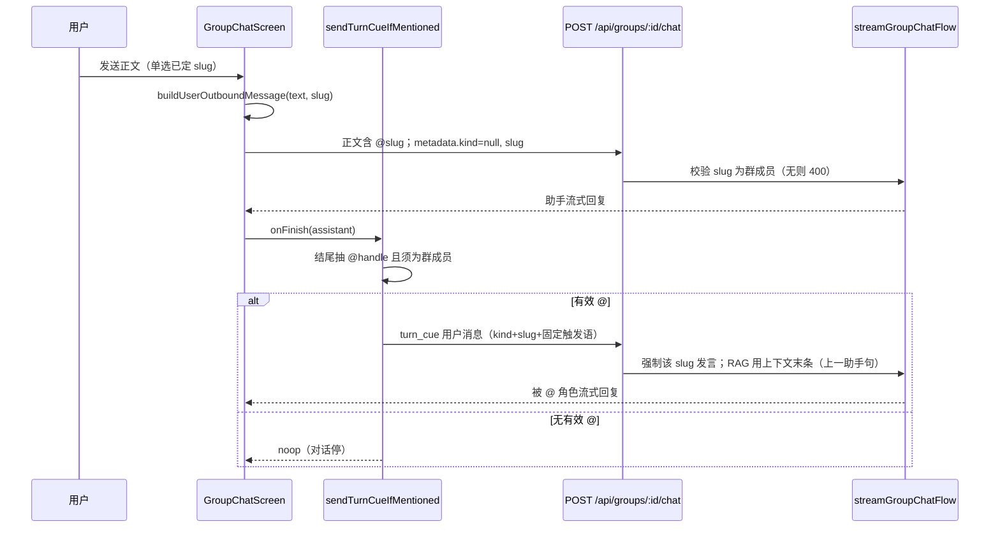

# 群聊 @ 与 turn_cue 续聊

群内 AI 互相点名、接力发言的前端编排 + 后端选角协议。

## 说明

- **谁决定召唤谁**：
  - **用户主动发送**：左侧单选展示当前成员 **displayName**（`localStorage` 按群 sticky）；发送时正文前拼 `@slug `，`metadata.slug` **由单选直接写入**（不解析用户正文）。
  - **助手续聊**：从助手正文**结尾**解析 `@handle`（见下方规则），发 `turn_cue`。
- **后端**：只读最后一条 user 的 `metadata.kind` / `metadata.slug`；普通用户消息**必须**带有效群内 slug（**无默认 speaker**）；校验成员后选 speaker。
- **被召唤角色** system 含 **`<group_roster>`**（人类用户 `@昵称` handle + AI 成员 `@slug` / 展示名 / `shortBio`，简介超 40 字截断），并标出当前发言者 `(you, speaking this turn)` 与本轮已发过言的成员 `(spoke already this round)`；示例块 `<group_chat_examples>` 按 `user.locale` 取 `group-chat-examples.{zh,en}.md`，群里只有自己时不注入。
- **turn_cue**：特殊用户消息（`kind: 'turn_cue'`），正文是固定触发语 `TURN_CUE_TEXT`（不随界面语言变化），**不进气泡列表**（`isDisplayMessage`）；**不进**历史分页（`getGroupHistoryPage`）与上下文窗口（`getGroupContextMessages`）；**本次召唤**仍把 cue 正文作为 ephemeral user 回合注入 LLM（否则对话以 assistant 结尾易空回复）；RAG 取上下文末条干净正文（用户句或上一助手句，见 `extractLatestContextTextForRag`）；进模型前再经 `withGroupSpeakerLabelsForModel` 加 `(slug):`。

### 助手正文 handle 规则（turn_cue）

正则：`/\s*@([^\s@]+)\s*$/` —— 只认**结尾**的 handle。

- 合法：`交给你了\n@lilia`、`你觉得呢？@lilia`、整条只有 `@lilia`
- 不算：`交给 @lilia 吧`（句中出现）、`@莉莉娅`（中文昵称不是成员 slug）、结尾是人类昵称（不召唤，本轮结束）

实现：`GroupChatScreen.utils.ts` 内私有 `extractTrailingMentionSlug`（仅助手续聊用）。
落库前用 `stripLeadingSpeakerLabels` 剥掉模型偶发模仿的 `(slug):` 标注（`group/chat.service.ts` onEnd）。

## 流程

### 1. 用户主动发送

| 步骤 | 行为 |
|------|------|
| 选人 | 左侧单选 displayName；`localStorage` 按群 sticky；无效回落默认角色 |
| 组出站 | `buildUserOutboundMessage(text, slug)` → 正文 `@slug …` + `{ kind: null, slug }` |
| 后端 | **必须**带 slug 且为群成员；否则 400（无默认 speaker） |
| RAG | 用本条用户正文（含 `@slug` 前缀） |

### 2. 助手结束后自动续聊

| 步骤 | 行为 |
|------|------|
| 触发 | `useChat` `onFinish`，且非 abort/error，role=assistant |
| 编排 | `sendTurnCueIfMentioned({ assistantParts, members, sendMessage, hopCount })` |
| 条件 | 正文**结尾**是 `@slug` **且** `members` 含该 slug，否则 noop |
| 发出 | `kind: turn_cue`，`slug`，正文固定为 `TURN_CUE_TEXT`（`'[system] Your turn. Carry on as yourself.'`） |
| 后端 | 必须带 slug；speaker 固定为该成员；RAG 取上下文末条助手正文 |

可多轮接力：A @ B → turn_cue → B 回复再 @ C → 再 cue，直到某次回复没有有效群内 @，或自动续聊达到 **5** 轮上限（前端熔断，触顶 toast「续聊轮次已达上限」）。

## 代码入口

| 层级 | 路径 |
|------|------|
| 前端编排 | `src/app/groups/components/GroupChatScreen.tsx`（`onFinish` / 用户提交） |
| @ 选人 / sticky / turn_cue 工具 | `src/app/groups/components/GroupChatScreen.utils.ts`（`TURN_CUE_TEXT` / `extractTrailingMentionSlug`） |
| 群 system prompt 组装 / 花名册 / 示例 | `src/services/group/prompt.service.ts`、`group/prompt.utils.ts`、`src/prompts/group-chat-rules.md`、`src/prompts/group-chat-examples.{zh,en}.md` |
| 单测 | `tests/app/groups/GroupChatScreen.utils.test.ts`、`tests/services/group/*.test.ts`、`tests/prompts/load.test.ts` |
| metadata / 展示过滤 | `src/types/message-kind.ts`（`MESSAGE_KIND_TURN_CUE`、`isDisplayMessage`） |
| API body | `src/schemas/api/groups/chat-post.ts` |
| 选角 + 流 | `src/services/group/chat.service.ts`（`streamGroupChatFlow`） |
| 落库 / 历史与上下文排除 cue / 说话人前缀与 RAG 句 | `group/message.service` + `group/message.utils` |

## 注意

- 用户出站 **不**解析正文 `@`；`metadata.slug` 来自单选。助手气泡里的 `@xxx` 仍是模型自由文本，靠 prompt 约束，由前端解析后发 turn_cue（气泡里暂不剥离 handle 原文）。
- turn_cue 会出现在 `useChat` 的 `messages` 里（供链路与 loading），但 UI 列表应过滤掉。
- 改触发语文案动 `TURN_CUE_TEXT`（不随语言变化；群规则管「怎么 @」，两者独立）；改结尾 handle 匹配动 `extractTrailingMentionSlug`；改花名册状态标记动 `formatGroupRoster`。
