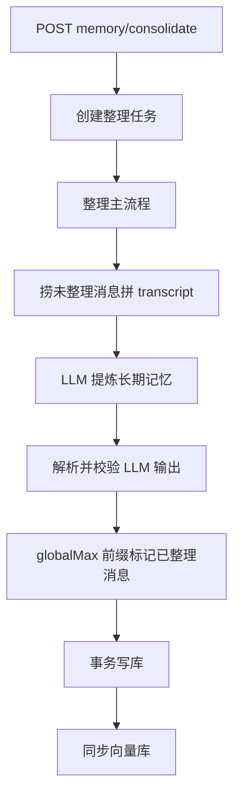

# 对话记忆整理 extract

← [返回总览](./pipeline.md)

## 说明

### 目的

从**已完结会话**的对话中，用 LLM 提炼可长期保留的用户事实，写入 `UserMemory`（`preference` / `event` / `fact`），并标记对应消息为已整理。

### 何时进入整理池

同时满足：

- 消息 `isConsolidated = false`
- 所属会话 `status = completed`（需先 `POST sessions/complete` 完结话题）

**没有**「消息太旧就跳过」的时间 cutoff；只要未标记且会话已完结，就会进入下一次 extract。

### Transcript 构建

- 按消息 `createdAt` **正序**拼接
- 每条消息格式为 `<message id="..." seq="...">`；`seq` 为从 0 起的相对序号，**不带**绝对时间给 LLM
- LLM 须按对话先后理解话题边界（含 A→B→A 分段）

### LLM 产出与进度标记

- 输出 `finished_memories`：每条含 `text`、`type`、`confidence`、`source_message_ids`
- 只有**已聊完、有持久价值**的话题块才产出记忆；末尾聊到一半的话题不得写入
- **`globalMax` 前缀标记**：取所有已完结话题中，时间顺序最后一条记忆所覆盖的消息下标；`messageIds[0..globalMax]` 标为 `isConsolidated=true`，其余 `deferredIds` 留待下次 job

### 落库

- MySQL **事务内**：新建 `UserMemory` + 标记消息已整理
- 事务**外**：同步 Chroma 向量
- 新记忆默认 `isMaintained = false`，供后续 [maintain](./maintain.md) 消费

### 与 chat / maintain 的关系

- extract **只写入**记忆，不读向量库、不做衰减
- 聊天 RAG 与维护 job 在 extract **之后**使用这些记忆

## 功能与代码对应

| 功能 | 函数 |
|------|------|
| 创建 job 并清理旧记录 | `prepareConsolidationJob` |
| 整理主流程编排 | `runConsolidation` |
| 构建待整理对话 transcript | `buildTranscript` |
| LLM 提取 finished_memories | `extractMemoriesFromTranscript` |
| 解析 / 校验 LLM 输出与 message id | `mapConsolidationOutput`, `validateAndMergeIds` |
| 落库：标记消息 + 新建记忆 | `persistConsolidation`, `buildUserMemoryWritePayload` |
| 向量库同步 | `syncUserMemoriesToChroma` |
