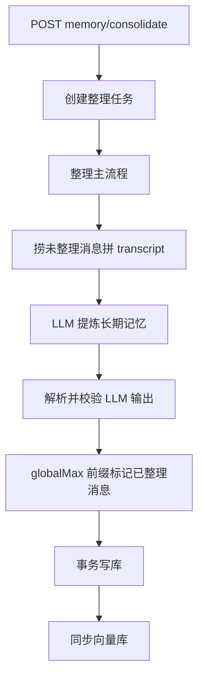

# 对话记忆整理 extract

← [返回总览](./pipeline.md)

## 功能与代码对应

| 功能 | 函数 |
|------|------|
| 创建 job 并清理旧记录 | `prepareConsolidationJob` |
| 整理主流程编排 | `runConsolidation` |
| 构建待整理对话 transcript | `buildTranscript` |
| LLM 提取 finished_memories | `extractMemoriesFromTranscript` |
| 解析 / 校验 LLM 输出与 message id | `mapConsolidationOutput`, `validateAndMergeIds` |
| 落库：标记消息 + 新建记忆 | `persistConsolidation`, `buildUserMemoryWritePayload` |
| 向量库同步 | `syncUserMemoriesToChroma` |
