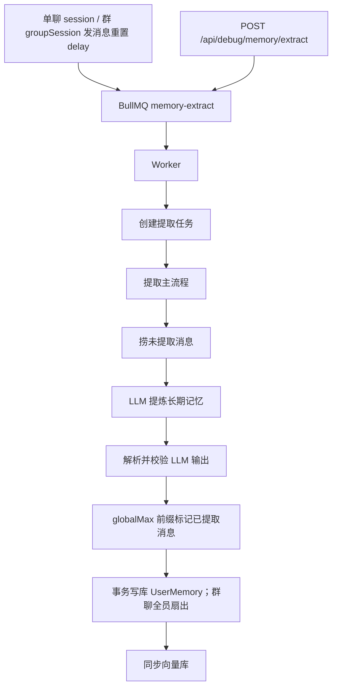

# 对话记忆提取 extract

← [返回总览](./pipeline.md)

## 说明

### 目的

从**单聊会话**或**群聊**中用 LLM 提炼可长期保留的用户事实，写入 `UserMemory`（按 `userId + characterId` 私有），并标记对应消息为已提取。

- **单聊**：写入该会话角色
- **群聊**：**一次**提取后，按 **job 执行时** 的全部 `GroupMember` **全员扇出**写入各角色私有记忆（旁听也记住）；文案为与单聊同款的中性事实句

### 何时触发

- **滑动窗口（单聊按 session）**：发聊天消息后调度 `extract-${sessionId}`（`MEMORY_EXTRACT_IDLE_MINUTES`）；同会话再次发消息会重置
- **滑动窗口（群聊按 groupSession）**：用户发群消息（含 turn_cue）后调度 `extract-group-${groupSessionId}`；同群再次发消息会重置；**不**调度 maintain
- **立即触发（测试，仅 development）**：
  - 单聊：`POST /api/debug/memory/extract?username=&sessionId=`
  - 群聊：`POST /api/debug/memory/extract?username=&groupSessionId=`
  - 二者互斥；本进程异步跑 `runExtract`，返回可轮询 `jobId`（`GET /api/debug/memory/jobs?jobId=`，不经 Bull）
- Worker：`pnpm worker:memory-extract`，消费滑动窗口入队的任务（单聊 / 群聊同一队列）

### 何时进入提取池

- 消息 `isExtracted = false` 且 `isDeleted = false`
- 属于本次 job 的 `sessionId` 或 `groupSessionId`
- **群聊排除** `kind = turn_cue`（不进 transcript，但仍可重置闲置窗口）

未聊完的话题仍靠 LLM `globalMax` / deferred 留到下次。

### transcript 构建

- 按消息 `createdAt` **正序**拼接
- 每条消息格式为 `<message id="..." seq="..." speaker="..." local_time="...">正文</message>`；`seq` 为从 0 起的相对序号；`local_time` 为该条 `createdAt` 按用户 IANA 时区格式化的本地墙钟（`yyyy-MM-dd HH:mm:ss`）
- 每条 `<message>` 含 `speaker` 属性（`extractSpeaker`）：`user` 或角色 **slug**；正文为纯对话（单聊 / 群聊一致）
- utils **无内置默认**；assistant 须显式带 `assistantSlug`
- LLM 须按对话先后理解话题边界（含 A→B→A 分段）
- system prompt：`<extract_rules>` + `<character_extract_focus>`（`jobs/extract.md` + `characters/{slug}/jobs/extract.md`，每个角色必有）
- user prompt：`<conversation>` 包 transcript
- 「明天」「今晚」相对**该条** `local_time` 换算，不用 extract 任务运行时刻
- 用户 `timeZone`：注册写入，每次聊天请求覆盖

### LLM 产出与进度标记

- 输出 `finished_memories`：每条含 `text`、`type`、`confidence`、`source_message_ids`
- 只有**已聊完、有持久价值**的话题块才产出记忆；末尾聊到一半的话题不得写入
- **同一话题块可产出多条**原子记忆（一条一个可检索事实，共用该块 `source_message_ids`），不要把整段压成一条纪要
- **`globalMax` 前缀标记**：取所有已完结话题中，时间顺序最后一条记忆所覆盖的消息下标；`messageIds[0..globalMax]` 标为 `isExtracted=true`，其余 `deferredIds` 留待下次 job
- 群聊消息进度**只标一次**（不按角色重复推进）

### 落库

- MySQL **事务内**：新建 `UserMemory`（**`userId + characterId` 私有**；群聊为成员数 × 记忆条数）+ 标记消息已提取
- 事务**外**：同步 Chroma 向量
- 新记忆默认 `isMaintained = false`，供后续 [maintain](./maintain.md) 消费（群聊路径**不**自动入 maintain 队，靠之后单聊或手动触发）

### 与 chat / maintain 的关系

- extract **只写入**记忆，不读向量库、不做衰减
- 聊天 RAG 与维护 job 在 extract **之后**使用这些记忆（按角色私有检索 / 维护）
- 单聊发消息仍同时调度 extract + maintain→profile；群聊只调度 extract

## 功能与代码对应

| 功能 | 函数 |
|------|------|
| 单聊滑动窗口 / 立即入队 | `scheduleMemoryExtract(sessionId, userId)` |
| 群聊滑动窗口入队 | `scheduleGroupMemoryExtract(groupSessionId, userId)` |
| Worker 消费 | `src/workers/memory-extract.worker.ts` |
| 创建 job 并清理旧记录 | `prepareMemoryJob` |
| 提取主流程编排 | `runExtract`（`sessionId` 或 `groupSessionId`） |
| 构建待提取对话 transcript | `buildSessionTranscript` / `buildGroupTranscript` |
| transcript speaker 属性 | `extractSpeaker` |
| LLM 提取 finished_memories | `extractMemoriesFromTranscript` |
| 解析 / 校验 LLM 输出与 message id | `mapExtractOutput`, `validateAndMergeIds` |
| 全员扇出展开 | `fanOutMemoriesToCharacters` |
| 落库：标记消息 + 新建记忆 | `persistExtract`, `buildUserMemoryWritePayload` |
| 向量库同步 | `syncUserMemoriesToChroma` |
