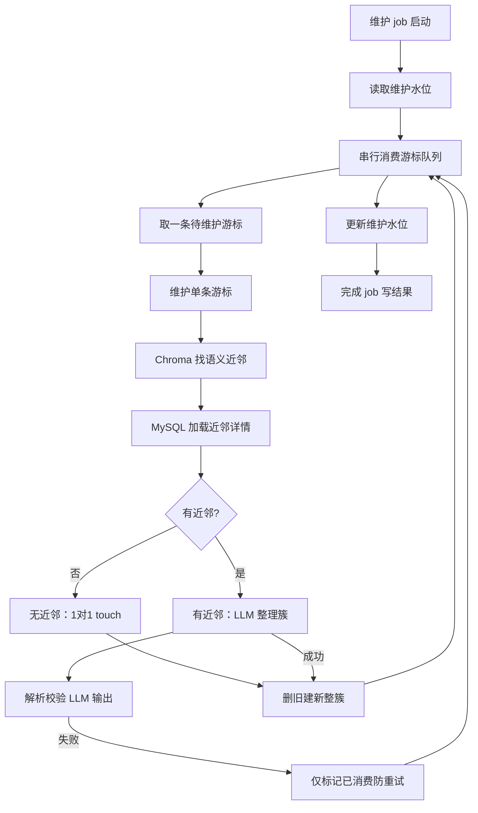

# 记忆维护 maintain

← [返回总览](./pipeline.md)

## 功能与代码对应

| 功能 | 函数 |
|------|------|
| 维护 job 主流程 | `runMaintenance`, `completeMaintenanceJob` |
| 读取 / 更新批级水位 | `getLastMaintainedAt`, `updateLastMaintainedAt` |
| 串行消费游标队列 | `runMaintenanceLoop`, `findNextUnmaintainedMemory` |
| 单条游标维护编排 | `maintainOneMemory` |
| 语义近邻召回与详情加载 | `findMemoryNeighbors`, `loadActiveMemoriesByIds` |
| 无近邻 touch（不调 LLM） | `buildCursorTouchMemories` |
| 有近邻时 LLM 整理 | `decideMaintenanceRewrite`, `buildMaintenancePrompt` |
| 解析 / 校验维护输出 | `mapMaintenanceRewriteOutput`, `validateMaintenanceRewriteOutput` |
| 确定删除范围（游标+近邻） | `buildMaintenanceClusterDeleteIds` |
| 删旧建新 | `applyClusterRewrite`, `applyMaintenanceMerge` |
| LLM 失败防重试 | `markMemoryMaintained` |
