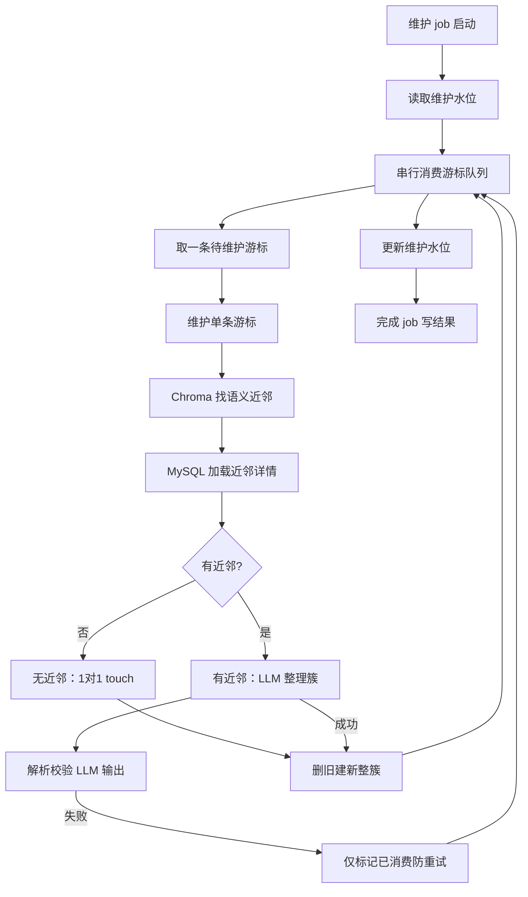

# 记忆维护 maintain

← [返回总览](./pipeline.md)

## 说明

### 目的

对库内 `UserMemory` 做语义去重与合并（删旧建新），减少 [extract](./extract.md) 产生的重复或近义条目。

### 游标（本批主条）

每条游标是一条待维护记忆，选取条件：

- `isDeleted = false`
- `isMaintained = false`
- 若存在批级水位 `UserProfile.lastMaintainedAt`，还要求 `createdAt > 水位`

**不是**「太旧就不维护」：水位只限定本批增量边界；首次维护时水位为 null，所有未维护条都会进队。游标按 `createdAt` 升序串行处理。

### 近邻召回与过滤

维护一条游标时，先找语义近邻，再决定是否调 LLM 合并：

| 阶段 | 规则 |
|------|------|
| Chroma | 按游标 `text` 语义距离，取 top `MEMORY_MAINTENANCE_NEIGHBOR_LIMIT`（默认 10） |
| MySQL | 仅 `isDeleted = false`（软删为 MySQL + Chroma 双写且非原子，此处兜底，与聊天 RAG 一致） |
| 衰减 | `decay(lastActiveAt) < MEMORY_MAINTENANCE_NEIGHBOR_MIN_DECAY` 的近邻**硬丢弃**，不进 LLM 簇 |

近邻**不要求** `isMaintained = false`：已维护过的老记忆仍可能因语义相近被卷入合并簇。

### 为何近邻衰减过滤是安全的

聊天 RAG 会对语义命中的记忆调用 `touchMemories`，回写 `lastActiveAt`。仍被用户反复聊到的旧记忆会持续保持「活跃」。

维护近邻过滤掉的是久未 touch、衰减权重已低的条目——它们并非仍在发挥作用的重要记忆。**因为聊天会 touch 语义相似的旧记忆，故不存在重要的旧记忆，无需担心跳过重要记忆。**

与聊天 RAG 的区别：RAG 将 decay **乘入** `effectiveScore` 做软排序，旧记忆仍可能因语义极近进 top-N；maintain 对近邻是**硬 cutoff**，低于阈值一律不进入合并簇。

### 分支行为

- 衰减过滤后**无近邻**：1→1 touch（删旧建新、内容不变），不调 LLM，刷新 `isMaintained`
- **有近邻**：LLM 整理簇 → `applyMaintenanceMerge` 删除游标 + 近邻、写入合并后的新条
- LLM 输出失败：`markMemoryMaintained` 标记已消费，避免同一条游标无限重试

### 相关 env

见 [`.env.example`](../../.env.example)「记忆衰减」「记忆 / 聊天调参」：

| 变量 | 用途 |
|------|------|
| `MEMORY_HALF_LIFE_*_DAYS` | 各类型半衰期，用于近邻 `decay(lastActiveAt)` 计算 |
| `MEMORY_MAINTENANCE_NEIGHBOR_LIMIT` | 每条游标最多召回的语义近邻数 |
| `MEMORY_MAINTENANCE_NEIGHBOR_MIN_DECAY` | 近邻最低衰减权重，低于此值不进入 LLM 簇 |
| `LLM_STRUCTURED_MAX_RETRIES` | 维护 LLM 结构化输出失败重试次数 |

## 功能与代码对应

| 功能 | 函数 |
|------|------|
| 维护 job 主流程 | `runMaintenance`, `completeMaintenanceJob` |
| 读取 / 更新批级水位 | `getLastMaintainedAt`, `updateLastMaintainedAt` |
| 串行消费游标队列 | `runMaintenanceLoop`, `findNextUnmaintainedMemory` |
| 单条游标维护编排 | `maintainOneMemory` |
| 语义近邻召回与详情加载 | `findMemoryNeighbors`, `loadActiveMemoriesByIds` |
| 无近邻 touch（不调 LLM） | `buildCursorTouchMemories` |
| 有近邻时 LLM 整理 | `decideMaintenanceRewrite`, `buildMaintenancePrompt` |
| 解析 / 校验维护输出 | `mapMaintenanceRewriteOutput`, `validateMaintenanceRewriteOutput` |
| 确定删除范围（游标+近邻） | `buildMaintenanceClusterDeleteIds` |
| 删旧建新 | `applyClusterRewrite`, `applyMaintenanceMerge` |
| LLM 失败防重试 | `markMemoryMaintained` |
