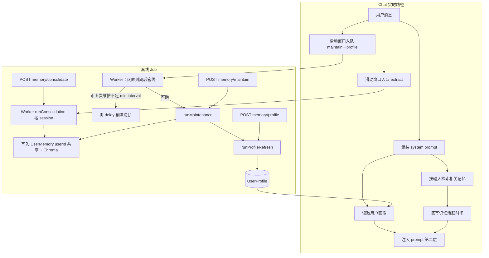

# 记忆流水线总览

- [对话记忆整理 extract](./extract.md)（行为说明见文档内 **「说明」**）
- [记忆维护 maintain](./maintain.md)（行为说明见文档内 **「说明」**）
- [画像维护 profile](./profile.md)

## 功能与代码对应

各 job 的选取规则、时间/衰减逻辑、落库约定见 [extract](./extract.md#说明) / [maintain](./maintain.md#说明) 的 **「说明」** 节。

| 功能 | 函数 |
|------|------|
| 组装 system prompt（人设 + 画像 + 记忆） | `buildSystemPrompt`（人设 / jobs 文案：`src/prompts/`） |
| 读取并格式化用户画像 | `fetchUserProfile`, `getUserProfileText` |
| 语义检索 + 衰减重排 + 滤已删记忆 | `fetchHistoricalContext`, `queryMemoryWithDecay`, `effectiveScore` |
| RAG 命中后刷新活跃时间 | `touchMemories` |
| extract 入队（按 session 滑动窗口） | `scheduleMemoryExtract` |
| maintain→profile 入队（按 user 滑动窗口；默认闲置 6h） | `scheduleMaintainPipeline` |
| 串行 maintain→profile；两者成功后写 `User.lastMemoryPipelineAt` | `runMaintainPipelineForUser` |
| 冷却计时（距上次管线成功不足 min interval 则再推迟） | `getLastMemoryPipelineAt` |
| 对话记忆整理 job | `runConsolidation`（详见 [extract](./extract.md)） |
| 记忆维护 job | `runMaintenance`（详见 [maintain](./maintain.md)） |
| 画像 rollup job | `runProfileRefresh`（详见 [profile](./profile.md)） |

开发需另开：`pnpm worker:memory-extract`、`pnpm worker:memory-maintain`（Redis 已起）。
