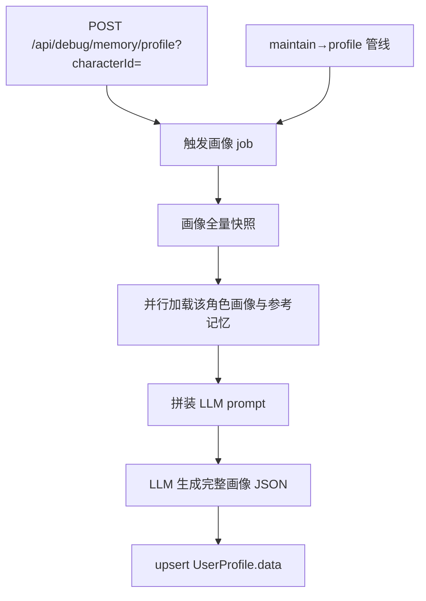

# 画像维护 profile

← [返回总览](./pipeline.md)

## 说明

### 目的

按 **userId + characterId** 私有：从该角色下的长期记忆维护用户画像（每轮注入，只收束怎么回，不是生平摘要），以 JSON 存 `UserProfile.data`，单聊 / 群聊注入 prompt 时转为 YAML。字段闭集：`communication_style`、`avoid_topics`、`now`。称呼用账号 `nickname`（注入时写入 YAML，不进画像）。爱好、职业细节、一次性日程由 RAG 按需检索；进行中的身份或心情可压进 `now`。

system prompt：`<user_profile_rules>`（`jobs/user-profile.md`）。角色 overlay 可选：有 `characters/{slug}/jobs/user-profile.md` 且非空时才拼 `<character_user_profile_focus>`。

### 何时触发

- **管线**：某角色 maintain 成功后串行跑该角色 profile（见 [pipeline](./pipeline.md)）
- **立即触发（测试，仅 development）**：`POST /api/debug/memory/profile?username=&characterId=`；须为通讯录好友；本进程异步跑，返回 `jobId`

### 参考记忆

- 该角色 `isDeleted=false` 的记忆（含 event）；一次性日程由提示词排除，不写入画像
- 按 confidence / lastActiveAt 取 top `MEMORY_PROFILE_REFERENCE_LIMIT`

删通讯录**不删**画像（与记忆一致，加回好友可继续用）。

## 功能与代码对应

| 功能 | 函数 |
|------|------|
| 画像 job 入口 | `runProfileRefresh` |
| 加载数据并调用 LLM 全量快照 | `refreshUserProfile` |
| 拼装刷新 prompt | `buildProfileRefreshPrompt` |
| 读画像注入 prompt | `getUserProfileText`（账号 `nickname` + `jsonToYaml`） |
| LLM 调用 | `generateProfileModelOutput`（`generateText` + `Output.object`） |
| 调试 dry-run | `/debug/profile`、`generateProfileModelOutput`（不写 UserProfile） |
