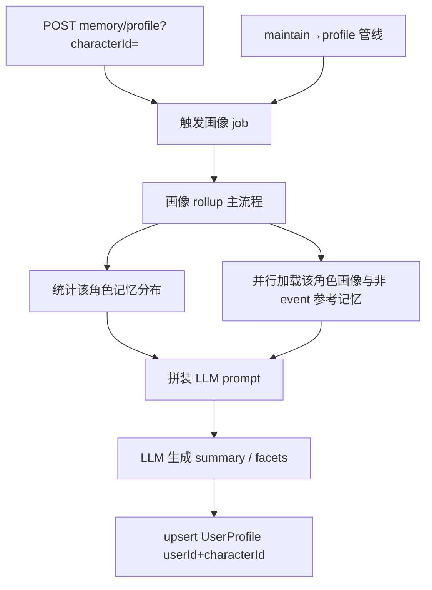

# 画像维护 profile

← [返回总览](./pipeline.md)

## 说明

### 目的

按 **userId + characterId** 私有：只用该角色下的长期记忆 rollup 出 summary / facets，供该角色单聊 / 群聊发言时注入 prompt。

### 何时触发

- **管线**：某角色 maintain 成功后串行跑该角色 profile（见 [pipeline](./pipeline.md)）
- **立即触发（测试）**：`POST /api/memory/profile?username=&characterId=`；须为通讯录好友；本进程异步跑，返回 `jobId`

### 参考记忆

- 仅该角色 `isDeleted=false` 且 `type != event` 的记忆
- 按 confidence / lastActiveAt 取 top `MEMORY_PROFILE_REFERENCE_LIMIT`

删通讯录**不删**画像（与记忆一致，加回好友可继续用）。

## 功能与代码对应

| 功能 | 函数 |
|------|------|
| 画像 job 入口 | `runProfileRefresh` |
| 加载数据并调用 LLM rollup | `refreshUserProfile` |
| 记忆库 type 统计 | `loadMemoryStats` |
| 拼装刷新 prompt | `buildProfileRefreshPrompt` |
| 读画像注入 prompt | `getUserProfileText` |
| 结构化 LLM 调用 | `generateText` |
