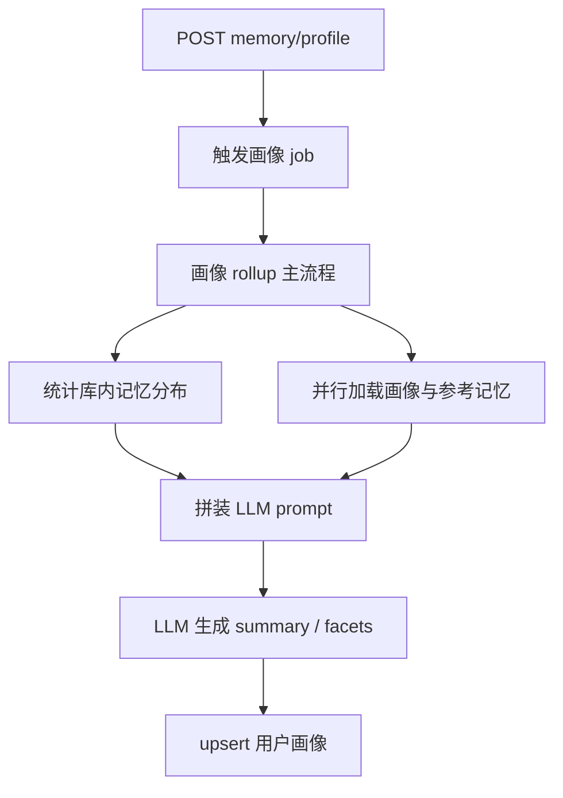

# 画像维护 profile

← [返回总览](./pipeline.md)

## 功能与代码对应

| 功能 | 函数 |
|------|------|
| 画像 job 入口 | `runProfileRefresh` |
| 加载数据并调用 LLM rollup | `refreshUserProfile` |
| 记忆库 type 统计 | `loadMemoryStats` |
| 拼装刷新 prompt | `buildProfileRefreshPrompt` |
| 结构化 LLM 调用 | `generateText` |
